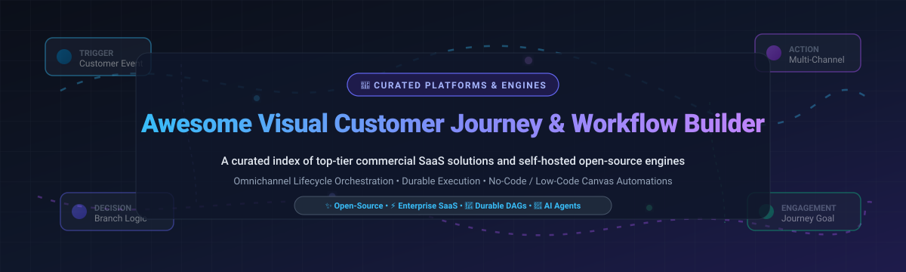

# Awesome Visual Customer Journey & Workflow Builder

  

  
  
  
  
  
  

> 🧭 A comprehensive, curated index of premier **Visual Customer Journey Builders**, **Workflow Automation Engines**, **Customer Journey Mapping (CJM)** software, and **No-Code / Low-Code Canvas Orchestrators**. Discover cutting-edge enterprise SaaS platforms and self-hosted, data-sovereign open-source solutions for multi-channel omnichannel engagement, durable DAG workflow execution, and automated customer lifecycle marketing.  
> 🌟 *Star this repository if you find it helpful for architecting customer experience pipelines!* 🌟

---

## 📑 Table of Contents

- [🌐 Sector Overview & Market Dynamics](#-sector-overview--market-dynamics)
- [🟦 SaaS / Hosted Platforms](#-saas--hosted-platforms)
- [🟩 Open-Source Software](#-open-source-software)
- [📊 Feature Comparison Matrix](#-feature-comparison-matrix)
- [🤝 Contributing](#-contributing)
- [💖 Support & Sponsor](#-support--sponsor)
- [📈 Star History](#-star-history)
- [📄 License](#-license)

---

## 🌐 Sector Overview & Market Dynamics

The global **Customer Journey Analytics & Orchestration (CJA/CJO)** market is valued at approximately **$18.6B – $20.8B**, while the broader **Workflow Automation & Management** market stands at **$22B – $25B**, expanding rapidly alongside enterprise AI and low-code digital transformation.

The sector exhibits a **moderately concentrated yet bifurcated market structure**: mega-cloud platforms (Microsoft, Salesforce, Celonis) dominate enterprise-wide suites and mission-critical customer records, while a dynamic, fragmented ecosystem of agile SaaS point-solutions and self-hosted open-source builders vigorously compete across visual flow builders, privacy-first durable execution, and developer-centric agentic automation.

---

## 🟦 SaaS / Hosted Platforms

Commercial, cloud-hosted visual customer journey and workflow automation builders. Sorted in **descending order by company scale** (market capitalization / valuation / annual revenue).

| Platform | Company Scale (Valuation / Revenue) | Starting Tier Pricing | Free Tier Limits / Free Trial Plan | Primary Automation Focus | Deployment |
| :--- | :--- | :--- | :--- | :--- | :--- |
| 🏢 **[Microsoft Power Automate](https://powerautomate.microsoft.com/)** | **~$3.9 Trillion** Market Cap (~$245B+ ARR) | **$15** / user / month *(Power Automate Premium, billed annually)* | **Free with eligible Microsoft 365** (standard connectors only, capped at 6,000 requests/user/day) or **90-day self-service full-featured trial** with attended RPA and premium connectors | Enterprise workflow automation, cloud & desktop RPA across Microsoft 365, Dynamics, and external systems | Hosted Cloud |
| ☁️ **[Salesforce Flow Builder](https://www.salesforce.com/products/platform/flow/)** | **~$185 Billion** Market Cap (~$38B+ ARR) | **$25** / user / month *(Starter Suite, billed annually; includes standard Flows)* | **30-day free trial** of Salesforce Sales/Service Cloud (Starter/Pro Suite with Flow functionality) or developer edition orgs with Flow Orchestration | Low-code customer journey orchestration and declarative business logic deeply embedded in Salesforce CRM | Hosted Cloud |
| 📊 **[Make](https://www.make.com/)** *(Celonis)* | **~$13 Billion** Celonis Valuation (~$700M+ ARR) | **$9** / month *(Core plan, 10,000 operations/month, billed annually)* | **Free forever plan**: 1,000 operations/month, max 2 active scenarios, 15-minute minimum execution interval, 5 MB file size limit | Visual node-based automation with granular JSON data transformation, branching, and routing | Hosted Cloud |
| ⚙️ **[Workato](https://www.workato.com/)** | **~$5.7 Billion** Valuation (~$150M+ ARR) | **$10,000** / year *(Base enterprise tier starting contract)* | **30-day free trial / sandbox** environment with access to recipe builders, enterprise connectors, and test workspaces | Enterprise iPaaS, IT governance, citizen-integrator workflows, and complex multi-system customer sync | Hosted Cloud |
| ⚡ **[Zapier](https://zapier.com/)** | **~$5.0 Billion** Valuation (~$400M+ ARR) | **$19.99** / month *(Professional plan, 750 tasks/month, billed annually)* | **Free forever plan**: 100 tasks/month, 2-step single-trigger single-action Zaps only, 15-minute polling interval (no multi-step or filter logic) | Broadest third-party app connectivity (7,000+ connectors) for no-code trigger-action customer sequences | Hosted Cloud |
| 👥 **[Freshworks Customer Journeys](https://www.freshworks.com/crm/marketing/customer-journeys/)** | **~$3.4 Billion** Market Cap (~$720M+ ARR) | **$9** / user / month *(Freshsales Growth) or **$19** / month (Freshmarketer 1,000 contacts)* | **Free forever plan**: Up to 3 users for basic CRM lifecycle sequences or up to 100 contacts; full-featured **21-day free trial** without credit card | Omnichannel marketing journey mapping, visual trigger/action blocks, delay branches, and campaign attribution | Hosted Cloud |
| 🔗 **[Tray.io](https://tray.ai/)** | **~$600 Million** Valuation (~$70M+ ARR) | **$1,000** / month *(Standard entry-level plan, billed annually)* | **30-day free trial** (and 14-day Tray Academy sandbox) with visual canvas access and core connector testing | Enterprise iPaaS, scalable cloud automation, and Tray Embedded for white-labeled customer journey builders | Hosted Cloud |
| 🔄 **[Relay.app](https://www.relay.app/)** | **Acquired / Legacy Service** *(~$50K ARR prior to shutdown)* | **$9** / month *(Starter plan prior to shutdown)* | **Free forever plan (historical)**: 200 workflow runs/month with human-in-the-loop validation steps | Human-in-the-loop approval workflows, team collaboration, and automated customer handoffs | Hosted Cloud *(Shut down Sept 2026)* |

---

## 🟩 Open-Source Software

Self-hosted, transparent, community-driven workflow automation platforms, customer journey engines, and visual orchestration tools. Sorted in **descending order by GitHub Stars_Count**.

| Project | GitHub_Stars | License | Primary Tech Stack | Description & Highlights |
| :--- | :--- | :--- | :--- | :--- |
| 🔀 **[n8n](https://github.com/n8n-io/n8n)** |  | Sustainable Use (Source-Available) | TypeScript, Node.js, Vue | Leading visual workflow automation platform with 500+ pre-built integrations, custom JavaScript/Python code execution, and native AI/LangChain agent orchestration. |
| 🤖 **[Dify](https://github.com/langgenius/dify)** |  | Apache-2.0 / Dual | Python, TypeScript, Next.js | Production-grade LLM app development and visual agentic workflow builder. Features visual prompt orchestration, multi-step RAG pipelines, and conversational journey nodes. |
| 🧠 **[Flowise](https://github.com/FlowiseAI/Flowise)** |  | MIT | TypeScript, React, LangChain | Drag-and-drop UI for orchestrating AI agents, memory-backed multi-step customer chatbots, interactive support journeys, and API-driven execution chains. |
| 🕵️ **[Huginn](https://github.com/huginn/huginn)** |  | MIT | Ruby, Rails, MySQL | Battle-tested open-source system for building automated agents that monitor events, scrape websites, parse webhooks, and trigger sequential cross-service customer workflows. |
| 🦔 **[PostHog](https://github.com/PostHog/posthog)** |  | PostHog / MIT | Python, TypeScript, ClickHouse | All-in-one developer platform featuring visual customer journey path analytics, cohort funnel exploration, feature flagging, automated user surveys, and session replays. |
| 📬 **[Novu](https://github.com/novuhq/novu)** |  | Apache-2.0 | TypeScript, React, Redis | Unified open-source notification infrastructure featuring a visual workflow editor for multi-channel messaging (Email, SMS, Push, Chat, In-App) with digestible delay steps. |
| 🧩 **[Activepieces](https://github.com/activepieces/activepieces)** |  | MIT | TypeScript, Angular, Node.js | Permissively licensed, no-code workflow automation engine with a sleek visual canvas, 400+ app connectors, MCP (Model Context Protocol) support, and self-hosted team workspaces. |
| 🔴 **[Node-RED](https://github.com/node-red/node-red)** |  | Apache-2.0 | JavaScript, Node.js | Low-code browser-based flow editor for event-driven applications, real-time message routing, IoT triggers, and API-level workflow orchestration across diverse endpoints. |
| 🤖 **[Automatisch](https://github.com/automatisch/automatisch)** |  | AGPL-3.0 | JavaScript, React, PostgreSQL | Privacy-centric self-hosted Zapier alternative that keeps customer tracking data within your private infrastructure. Build automated trigger-action flows without vendor lock-in. |
| 📧 **[Mautic](https://github.com/mautic/mautic)** |  | GPL-3.0 | PHP, Symfony, MySQL | The premier open-source marketing automation engine. Includes a full visual customer journey & campaign builder, lead scoring, dynamic email personalization, and CRM sync. |
| 🎯 **[GrowthBook](https://github.com/growthbook/growthbook)** |  | MIT | TypeScript, React, Next.js | Open-source experimentation and feature flagging platform that lets product teams build behavioral journey branches, targeted rollouts, and statistical A/B customer paths. |
| 📣 **[Laudspeaker](https://github.com/laudspeaker/laudspeaker)** |  | AGPL-3.0 | TypeScript, React, Express | Open-source customer engagement platform and alternative to Braze and Customer.io. Features a visual canvas for onboarding journeys, event-triggered push/email/SMS, and user segmentation. |
| ☀️ **[Helio](https://github.com/achref-soua/helio)** |  | AGPL-3.0 | TypeScript, React Flow, Temporal, ClickHouse | AI-native growth platform combining a high-scale CDP with a React Flow journey canvas. Features durable Temporal DAG execution, live-data branches, multi-channel messaging, and MCP AI agents. |
| ⚡ **[FlowForge](https://github.com/DeveloperSarim/FlowForge)** |  | AGPL-3.0 | PHP, Laravel, React | Lightweight, self-hosted automation engine designed for standard PHP shared hosting (cPanel/Hostinger) with a single cron job. Integrates 1,690 apps, AI builders, and automatic retries. |

---

## 📊 Feature Comparison Matrix

| Solution | Model | Visual Canvas | Execution Engine | Omnichannel Messaging | Built-in CDP / Segmentation | Self-Hosted | Target User |
| :--- | :--- | :--- | :--- | :--- | :--- | :--- | :--- |
| **Microsoft Power Automate** | SaaS | ✅ Drag-and-drop | Azure Cloud | Via connectors | Via Dynamics 365 | ❌ | Enterprise & M365 Ecosystem |
| **Salesforce Flow** | SaaS | ✅ Visual Canvas | Salesforce Engine | Multi-channel cloud | Native Salesforce CRM | ❌ | Salesforce Administrators |
| **Make** | SaaS | ✅ Circular Graph | Celonis Cloud | Via connectors | External CRM / DB | ❌ | Operations & Growth Engineers |
| **Workato** | SaaS | ✅ Recipe Editor | Workato iPaaS | Via connectors | Enterprise Data Lake | ❌ | Enterprise IT & Governance |
| **Zapier** | SaaS | ✅ Linear & Paths | Zapier Cloud | Via connectors | Tables / App Data | ❌ | No-Code Teams & SMBs |
| **Freshworks** | SaaS | ✅ Node Builder | Freshworks CRM | ✅ Native Email/SMS/WhatsApp | Native Freshsales CDP | ❌ | Marketing & Sales Teams |
| **Tray.io** | SaaS | ✅ Visual Canvas | Tray Engine | Via connectors | Custom integrations | ❌ | Mid-Market & Embedded SaaS |
| **n8n** | Self-Hosted / Cloud | ✅ Drag-and-drop | Node.js Runtime | Via 500+ nodes | Database queries | ✅ | Developers & Automation Pros |
| **Dify** | Self-Hosted / Cloud | ✅ Graph DAG | Python / Celery | Via LLM & API Nodes | Context Memory & Vector DB | ✅ | AI Engineers & Agent Builders |
| **Flowise** | Self-Hosted / Cloud | ✅ React Flow | Node.js Runtime | Chatbot / Webhook APIs | Vector Store / DB | ✅ | Generative AI Developers |
| **Huginn** | Self-Hosted | ⚠️ Agent Graph | Ruby / MySQL | Email, SMS, Webhooks | Event Stream DB | ✅ | DevOps & Web Scraping Engineers |
| **PostHog** | Self-Hosted / Cloud | ✅ Funnel Explorer | ClickHouse Firehose | Native In-App / Surveys | Native CDP & Cohorts | ✅ | Product Managers & Growth Leads |
| **Novu** | Self-Hosted / Cloud | ✅ Notification DAG | Redis / Node.js | ✅ Email, SMS, Push, In-App | Subscriber Management | ✅ | Full-Stack Product Developers |
| **Activepieces** | Self-Hosted / Cloud | ✅ Drag-and-drop | Node.js Sandbox | Via 400+ pieces | Native Storage / Tables | ✅ | Open-Source Enthusiasts & Teams |
| **Node-RED** | Self-Hosted | ✅ Wiring Canvas | Node.js Event Loop | TCP, MQTT, Webhooks | External Data Stores | ✅ | IoT & Integration Developers |
| **Automatisch** | Self-Hosted | ✅ Linear Builder | Node.js / Postgres | Via connectors | Internal App Data | ✅ | Privacy-Conscious Organizations |
| **Mautic** | Self-Hosted | ✅ Campaign Studio | Symfony / Cron | ✅ Email, SMS, Webhooks | Full Native Marketing CDP | ✅ | Marketing Automation Specialists |
| **GrowthBook** | Self-Hosted / Cloud | ✅ Feature Editor | SDK / Evaluation Engine | Webhooks & SDK events | Data Warehouse Direct Sync | ✅ | Product Experimentation Teams |
| **Laudspeaker** | Self-Hosted / Cloud | ✅ Flow Canvas | Express / Node.js | ✅ Email, SMS, Push | Native User Segmentation | ✅ | Product Onboarding & Lifecycle Teams |
| **Helio** | Self-Hosted | ✅ React Flow | ✅ Temporal Durable DAG | ✅ Email, SMS, Push, WhatsApp | Native ClickHouse CDP | ✅ | Growth Teams & Privacy-First Tech Stacks |
| **FlowForge** | Self-Hosted | ✅ React Canvas | PHP / Cron Engine | Via 1,690 apps | Database storage | ✅ | Shared Hosting & SMB Webmasters |

---

## 🤝 Contributing

Contributions are warmly welcomed! If you would like to suggest a new open-source or commercial customer journey builder, workflow engine, or update existing details:

1. 🍴 **Fork** this repository.
2. 🌿 Create a new feature branch (`git checkout -b feature/new-workflow-builder`).
3. 📝 Add your tool in alphabetical or sorted order with:
   - Official website or GitHub repository link.
   - Accurate license information and tech stack.
   - Clear starting tier pricing and specific free-tier constraints.
   - Specific highlights detailing what makes it unique.
4. 🚀 Open a well-documented **Pull Request**.

Please review the [contribution guidelines](https://github.com/ishandutta2007/Awesome-Awesome-Awesome) to ensure your submission meets our community standards.

---

## 💖 Support & Sponsor

If this curated visual customer journey index saved you research time or assisted in choosing the right workflow platform, please consider supporting the project:

- ⭐ **Star** this repository to increase its visibility for fellow engineers.
- 🍴 **Fork** and share the project with your engineering and marketing operations teams.
- ☕ **Buy a Coffee / Sponsor**: Support continued open-source research and maintenance via the [GitHub Sponsor Dashboard](https://github.com/sponsors/ishandutta2007).

Your sponsorship helps keep this knowledge base up to date with the latest landscape shifts in AI orchestration, automation standards, and open-source tooling.

---

## 📈 Star History

---

## 📄 License

This compilation is licensed under the [Creative Commons Zero v1.0 Universal](LICENSE) (CC0 1.0 Universal / Public Domain Dedication). All software products, trademarks, and registered brand names referenced herein remain the intellectual property of their respective owners.

  Built with ❤️ for automation enthusiasts, growth architects, and full-stack journey builders worldwide.

